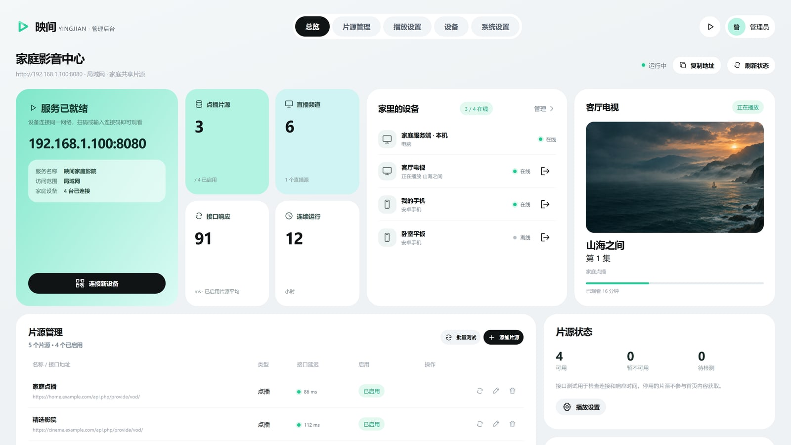
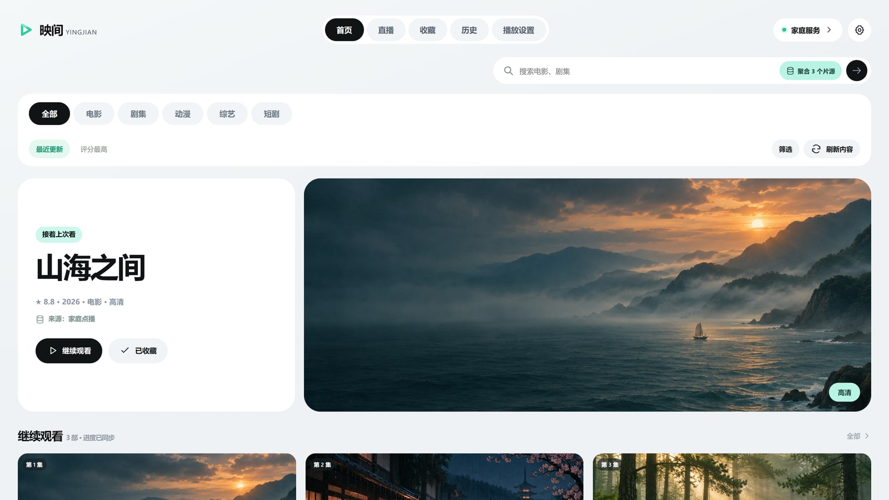
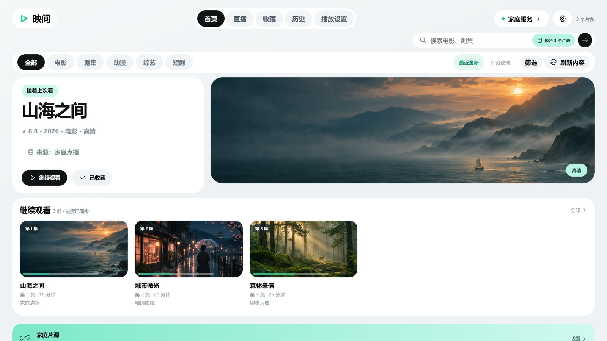

# 映间 · Yingjian

**把好电影，留在家里。**

映间是一款面向家庭局域网的聚合影音应用。电脑或 NAS 运行一份服务，手机、电脑和安卓电视连接同一家庭网络，共享片源、收藏和观看进度。

**作者：雪落a** · 仓库名称：`yingjian` · 服务端 / Windows 播放入口：`0.1.4` · Android 客户端：`0.1.2`

基于 LibreTV 的聚合观影思路打造；当前服务端、界面和客户端为独立实现，未包含 LibreTV 源码，非 LibreTV 官方版本。来源与依赖说明见 [THIRD-PARTY.md](THIRD-PARTY.md)。

## 下载与安装

前往 [最新版下载](https://github.com/Xueluoa1/yingjian/releases/latest)。当前部署更新为 **v0.1.4-nas2**，Windows 完整服务端内置 AMD64 和 ARM64 两种 NAS 镜像，可在“NAS 部署”中选择架构后离线导出。

| 设备 / 用途 | 下载文件 |
| --- | --- |
| Windows 服务端及 NAS 导出 | `Yingjian-Server-0.1.4-Windows.zip` |
| ARM64 / aarch64 NAS | `Yingjian-Server-0.1.4-nas1-linux-arm64-Offline.zip` |
| Intel / AMD x86-64 NAS | `Yingjian-Server-0.1.4-nas1-linux-amd64-Offline.zip` |
| Windows 播放端 | `Yingjian-Player-0.1.4-Windows.zip` |
| 安卓手机 / 电视 | 对应的 `Yingjian-Phone` / `Yingjian-TV` APK |

Windows 解压后运行 `Yingjian-Server.exe`。NAS 离线包先导入 `image.tar`，再使用随包 Compose 和配置启动，无需联网构建。ARM64 不包含 ARMv7 支持。升级保留原配置及数据卷，详见 [使用说明](docs/usage.md) 和 [NAS 架构选择](docs/nas-architectures.md)。

## 界面预览



| 电脑播放器 | 安卓电视布局 |
| --- | --- |
|  |  |

以上为当前 Web 界面配合演示数据的截图；片名、评分、延迟和设备状态为样例，并非预装片库或可用性承诺。手机使用同一套响应式 Web 界面，APK 提供原生连接与扫码入口。

## 主要功能

- **家庭共享**：服务端统一保存片源、配对设备、收藏和观看历史。
- **聚合浏览与搜索**：电影、剧集、动漫、综艺、短剧分类；年份、地区、类型筛选与更新时间 / 评分排序。
- **点播与直播**：支持苹果 CMS 兼容 JSON 接口、M3U 直播列表；详情、线路、选集和续播。
- **播放设置**：管理片源、测试接口延迟、选择浏览源、自动播放下一集；播放中匹配同一作品换源。
- **多端连接**：浏览器、Android 手机、Android TV；二维码、链接或六位连接码配对。
- **Windows / NAS**：Windows 桌面启动器可选择 AMD64 / ARM64，校验并导出对应的 NAS 离线镜像包。

局域网指设备访问自家服务端，互联网片源仍需联网。项目不内置影片、离线下载、转码、DLNA 投屏或外网穿透。筛选范围限于已加载内容，媒体格式取决于浏览器或 Android WebView。请使用有权访问的内容来源。

## 源码快速启动

安装 **Node.js 22 或更新版本**（建议 24），在仓库根目录执行：

```sh
npm ci
npm start
```

电脑访问 <http://127.0.0.1:8080/?view=server>，进入服务端管理。手机和电视需要使用服务端显示的局域网地址，例如 `http://192.168.1.100:8080`，不能使用 `127.0.0.1`。

首次运行自动创建 `data/household.json`。不要将它提交到 GitHub；其中包含家庭设备、会话及配对相关信息。备份、升级或迁移前先停止服务，并保留整个数据目录。

## 部署方式

| 平台 | 方式 | 说明 |
| --- | --- | --- |
| Windows x64 | 便携服务端包 | 双击 `Yingjian-Server.exe`；包含 Node.js，启动器需 .NET Framework 4.7.2+ |
| Windows / macOS / Linux | Node.js 源码运行 | `npm ci` 后 `npm start`，浏览器访问管理页 |
| NAS / Linux Docker | 源码构建 | 根目录 Compose 负责构建并保存持久化数据 |
| NAS x86-64 / AMD64 | 离线镜像包 | 导入已构建镜像，再使用随包 Compose；源码仓库不包含镜像 |
| NAS ARM64 / aarch64 | 离线镜像包 | 已通过原生 ARM64 容器验收；导入镜像后启动 Compose，不支持 ARMv7 |
| Android 手机 / 电视 | 对应 APK | Android 6.0+，需要可用的 WebView；当前为侧载调试签名版本 |

### Docker 从源码部署

复制 `.env.example` 为 `.env`，填写自己的 `ADMIN_PASSWORD`、`PUBLIC_ORIGIN` 和 `LAN_BIND_IP`，然后执行：

```sh
docker compose up -d --build
```

此方式需要联网下载基础镜像和 npm 依赖。仅在可信家庭网络访问，不配置路由器公网端口转发。已有安装升级时保留原项目、配置和数据卷；不要使用 `docker compose down -v` 删除数据。

安装包、APK 和离线镜像应作为 GitHub Release 附件单独提供，仓库源码不包含这些成品。源码仓库上传不会自动生成或发布安装包。

## 代码结构

```text
server/          服务端 API、片库聚合、媒体代理、数据持久化
public/          正式 Web 界面：管理端、手机/电脑播放端、电视布局
launcher/        Node.js 启动进程与 Windows WPF 启动器
player/          Windows 独立浏览器连接入口
android/         Android 手机与电视客户端、扫码组件、Java 测试
deployment/      NAS 源码部署与离线镜像部署模板
config/          初始片源与 Node.js 第三方声明
scripts/         构建、打包、校验与 GitHub 源码导出工具
tests/           服务端、播放逻辑和进程生命周期测试
ui/              历史设计原型与原创演示图，非正式运行入口
docs/            使用、开发、上传说明和轻量界面预览
.github/         自动检查、问题与 PR 模板
```

## 开发与检查

```sh
npm run check
npm test
npm run test:deployment
```

GitHub Actions 配置了 Windows / Ubuntu、Node.js 22 / 24 的检查矩阵。部署测试使用模拟 Docker，不能代替真实容器、NAS 或物理 Android 设备验收。

- [详细使用与维护](docs/usage.md)
- [NAS 架构选择与 ARM64 镜像制作](docs/nas-architectures.md)
- [开发与构建说明](docs/development.md)
- [GitHub 上传说明](docs/github-upload.md)
- [Android 构建与兼容性记录](android/README.md)
- [NAS 源码部署](deployment/nas/README.md) / [离线部署模板](deployment/nas-offline/README.md)
- [API 约定](API-CONTRACT.md)

## 作者与许可

作者：**雪落a**，见 [AUTHORS.md](AUTHORS.md)。

项目许可证暂未选定，本仓库尚未添加项目级开源许可证。第三方组件仍遵循各自许可证，见 [THIRD-PARTY.md](THIRD-PARTY.md) 和 [Android 第三方声明](android/THIRD-PARTY.md)。
